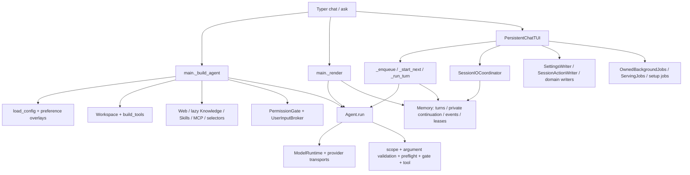
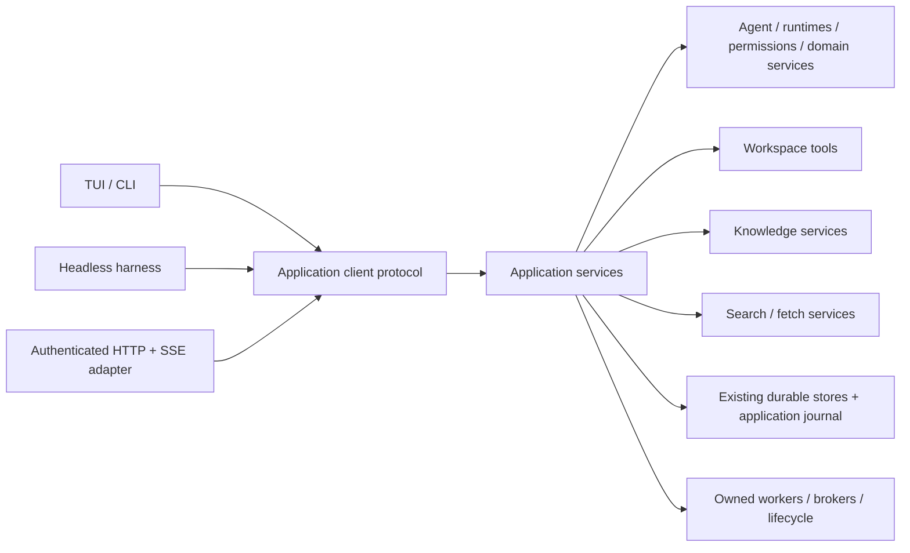

# RFC: Shared application bridge for Klaude

- **Status:** Proposed; architecture review required before implementation.
- **Date:** 2026-10-17.
- **Inspection baseline:** HEAD `90137f46f59f15346f16401c2ecd5b6aecc8a7f7`, including the current modified and untracked source files. This is not an audit of HEAD alone.
- **Deliverable:** Documentation only. No application package, server, hosting switch, migration, API, or frontend is implemented by this RFC.
- **Product inputs:** [WebUI planning specification v2](klaude-webui-planning-spec-v2.md), especially §§4–8 and traceability §§11–12; [feature inventory](../webui-feature-inventory.md), especially settings authorities, workflows, backend boundaries, and maintenance updates.

**Later implementation update (2026-10-18):** The loopback-only boundary below
describes the original v1 proposal. A subsequent user request added optional
private-LAN preview through a separate HTTP listener at the user's request. It is off by default,
binds one selected RFC1918 IPv4 address, warns that LAN traffic is unencrypted,
and retains exact Host/Origin and one-use
bootstrap checks. Public hosting, remote accounts and browser file mutations
remain outside the implemented preview.

## 1. Decision and scope

**Authentication amendment (2026-10-20, user-directed):** The production host now
uses a persistent local `admin` account with a random initial password and
password sign-in at the plain local/LAN URL, replacing the original fragment-link
bootstrap requirement below. The owner retrieves the initial password locally
from `/settings web`; private salted scrypt credentials, bounded login work,
CSRF/Host/Origin checks, session revision revocation and local password recovery
preserve the existing owner boundary. Browser password changes revoke all
sessions. A private initial-password file is removed after password change.
There is no public registration or multi-user workspace authorization. 2FA may
extend the versioned account verifier later and is not implemented. Historical
bootstrap tests remain for the embedded compatibility seam, and production
account-enabled hosts reject bootstrap exchange. LAN remains explicitly HTTP.

Introduce a transport-independent application layer that composes the existing `Agent`, tools, runtimes and stores. CLI, TUI, headless tests and a future Web host call the same use cases. Keep `Agent.run` as the execution engine. HTTP handlers validate and authorize requests, call application services and serialize explicit public contracts; they never construct a second agent loop or drive terminal screens.

Deliver this in slices: first a headless chat/approval/cancellation/resume path and the existing TUI using that same path; then a secure local host; only then a browser frontend. This RFC does not authorize any of those implementation phases.

The initial hosting target is one local Linux account, one configured Klaude profile, loopback access, and multiple clients/tabs belonging to that owner. No LAN listener, remote accounts, public hosting, multi-user sync, interactive PTY, arbitrary historical-message editing, or general task scheduler is included. Existing autonomous work remains bounded by the current governor, tool policy, workspace protection and read-only delegation rules. A persistent host is not permission to run indefinite autonomous work.

### 1.1 Recommended decisions for review

| Decision | Proposed baseline | Reason |
| --- | --- | --- |
| Shared layer | New `packages/application`, distribution `klaude-application`, import `klaude_application` | Composition needs core + tools + knowledge + web; putting it in core would invert existing dependencies |
| Terminal integration | In-process service adapter first; local IPC adapter when the runtime owner is running | Preserve ordinary CLI use with hosting off; share live control when hosted |
| Host | New optional `apps/webhost`, with a local runtime supervisor and separately stoppable HTTP listener | Browser lifetime and HTTP shutdown must not own a model turn or serving helper |
| Web transport | Versioned JSON commands/queries plus SSE for public events | Commands need acknowledgements; streaming is predominantly server-to-client; no PTY needs WebSocket |
| State | Existing stores remain authoritative; additive application journal and fencing metadata | Avoid copying all settings, sessions and jobs into a competing database |
| Concurrency | One active execution owner per session, independent client drafts, existing repository mutation lock | A tab is an observer/controller, not a second worker |
| Hosting preference | Default off; `config/webui.json` with versioned `enabled` and bind/port preferences | Distinct from Search, model serving and TUI appearance |
| Startup | Enabling starts the runtime/listener now; enabled preference starts hosting on the next Klaude launch; no login service initially | Clear persistence without silently installing an OS service |
| TUI exit | A separately launched runtime continues; embedded standalone work retains existing terminal cleanup behavior | Preserve compatibility while making hosted work independent |
| Remote mode | Deferred; reject non-loopback bindings in v1 | Existing same-account filesystem permissions are not multi-user authorization |
| Browser preferences | Separate `data/webui-preferences.json`, profile defaults plus device-local overrides | Never overwrite `appearance.json` or agent state |

These names, paths, wire fields and bounds are proposed contracts, not existing commands or keys. No `klaude serve` or hosting CLI syntax is established here. Any later CLI addition must update the actual command registry and help.

## 2. Current implementation and evidence

Source links below identify inspected files and symbols; use symbols rather than historical line numbers when implementing. This review used the required documents, targeted live source and test inspection, and the current diff. It did not run inference, contact providers, execute shell tools through Klaude, or run the unit suite. Existing validation reports are historical evidence, not new validation of this architecture.

### 2.1 Product corrections relative to the planning tables

The planning specification is desired direction, not the current capability database. Its embedded audit table and several older inventory paragraphs are stale:

- F086–F088 now have native image-service generation, receipts, scoped cancellation, explicit recovery and image-job management. [image_generation.py](../../packages/core/src/klaude_core/image_generation.py), [generation_commands.py](../../apps/cli/src/klaude_cli/generation_commands.py) and [S6 validation](../s6-completion-validation.md) establish implementation and recorded CPU/CUDA evidence. Wider quality/hardware certification remains separate.
- F098 optional AI tag suggestions are implemented, not merely planned. [image_tags.py](../../packages/core/src/klaude_core/image_tags.py) separates prepare/suggest/apply and checks selected tags against the proposal and current pixels. `ArtifactStore.apply_ai_tags` preserves manual tags. They require explicit generation and selected save; nothing tags automatically.
- Model Defaults is the current public label; `ai_defaults` remains a compatibility/storage name. Opening defaults performs bounded metadata discovery through [default_model_selection.py](../../apps/cli/src/klaude_cli/default_model_selection.py), with no permission to enable Vision or switch the active session.
- Image attachments already have bounded decoding, detail/frame/crop, private immutable snapshots and retry/resume behavior. Use [chat_images.py](../../packages/core/src/klaude_core/chat_images.py), [image_preparation.py](../../packages/core/src/klaude_core/image_preparation.py) and [attachment validation](../image-attachment-reliability-validation.md). Browser-safe document delivery remains new work.
- The dirty worktree adds `discover_tools`, bounded task-outcome tracking, phased workspace execution and transport/error improvements. [tool_discovery.py](../../packages/core/src/klaude_core/tool_discovery.py) searches enabled metadata and loads bounded schemas for a subsequent response; it grants no permission. [task_progress.py](../../packages/core/src/klaude_core/task_progress.py) tracks observed execution evidence, not semantic proof of completion. Preserve these changes during extraction.
- Hosting, authenticated full-agent HTTP contracts and browser themes remain planned. Paid-provider image certification and broader remote hardware coverage remain limited. Do not turn a source-confirmed adapter into a claim that every model/account works.

### 2.2 Current call map



| Existing seam and source | Current responsibility | Extraction treatment |
| --- | --- | --- |
| [`main._build_agent`](../../apps/cli/src/klaude_cli/main.py) | Config, Memory, Workspace, local tools, MCP tools, lazy Knowledge, Web, skills, selector, input broker, prompt enrichment, runtime/preferences | Move composition into an application factory, with explicit dependencies and deterministic cleanup; preserve public CLI wrapper temporarily |
| Same factory and `_change_agent_directory` | Call `Workspace.ensure_work_branch`, print runtime/branch notes; directory changes mutate the existing Workspace object | Split read-only discovery from explicit workspace activation. Browser GET/watch must never create/switch branches |
| `_system_prompt`, `_agent_configuration_context`, `_select_tool_names`, `_configured_mcp_tools`, `_delegate_task_result` in `main.py` | Policy-bearing tool/context construction, provider wrappers and delegation | Extract together with their regression tests; inject command metadata instead of importing Typer from application code |
| [`Agent.run`, `Tool`, `AgentEvent`](../../packages/core/src/klaude_core/agent.py) | Sync generator, provider calls, capability snapshots, scoped execution, retries, private model history | Reuse; add narrow execution observers where public contract needs actual facts; do not serialize its dictionaries wholesale |
| [`PermissionGate`](../../packages/core/src/klaude_core/permissions.py) | Ask/Allow/Deny with synchronous callback; `a` grants until process exit | Inject broker; existing callback only has name/detail, insufficient for exact argument-bound browser decisions |
| `UserInputBroker`, TUI `_ask_permission` / `_ask_user_input` | Blocking worker waits on events; terminal owns response delivery and cancellation | Extract correlation/wait/cancel state; retain terminal dialog/keyboard rendering |
| `_render` versus TUI `_run_turn` | Parallel orchestration of prompt preparation, leases, persistence, progress and terminal outcomes | Consolidate into TurnService incrementally; keep rendering separate |
| [`session_io.py`](../../apps/cli/src/klaude_cli/session_io.py) | Coalesced background SQLite reads, renewal, per-client drafts, ordered old-scope cleanup | Move coordinator/lease policy to shared layer; terminal polling frequency stays in adapter |
| [`Memory`](../../packages/core/src/klaude_core/memory.py) | WAL SQLite, public/private turns, runtime state, events, live lease, clients, crash recovery | Keep canonical storage; extend transactions and public projections, not a second session store |
| [`session_runtime.py`](../../packages/core/src/klaude_core/session_runtime.py), `_restore_session_runtime` | Explicit model/mode/effort plus endpoint/credential revisions; stale restore requires selection | Extract restoration/selection use case. Never infer selection from dialogue or use Default Chat as recovery fallback |
| [`settings_store.py`](../../packages/core/src/klaude_core/settings_store.py), [`SettingsWriter`](../../apps/cli/src/klaude_cli/settings_writer.py) | Stable advisory lock, field merge, fsync/replace; queued acknowledgements and drain | Preserve lock and storage semantics; typed application operations replace arbitrary browser JSON edits |
| [`SessionActionWriter`](../../apps/cli/src/klaude_cli/session_actions.py) | Typed session/fact/artifact/connection/default/secret/SSH mutations with UI acknowledgements | Split use cases from event tuples, preserving accepted-write completion and domain revision checks |
| [`OwnedBackgroundJobs`](../../apps/cli/src/klaude_cli/background_jobs.py), [`background_worker.execute`](../../apps/cli/src/klaude_cli/background_worker.py) | Fixed operation subprocesses, private stdin, bounded output, deadlines, replacement IDs, process-group cleanup | Shared worker infrastructure and typed dispatch; browser cannot submit raw worker dictionaries |
| [`ServingJobs`](../../apps/cli/src/klaude_cli/serving_jobs.py), [`managed_serving`](../../packages/core/src/klaude_core/managed_serving.py), SSH services | Persistent stdin-owned helper, reviewed identity, ready/stop/reconciliation, two owned servers per current client | Explicit owner and resource policy; hosted helpers belong to runtime, never a request/tab |
| [`library_knowledge.py`](../../apps/cli/src/klaude_cli/library_knowledge.py) and domain panels/commands | Some nonvisual operations still in CLI; panels combine reviews, workers and state | Move operation preparation/execution, retain panel drafts/navigation in CLI |

### 2.3 Important guarantees and gaps found in source

1. `Memory.acquire_session_lease` uses `BEGIN IMMEDIATE`, rejects archived/live competing owners and defaults to a 60-second lease. Renew/release match session, owner and turn. **This is the existing execution lease, not browser authentication.**
2. `publish_session_event` appends ordered IDs and updates matching live partial text. Its insert is not itself fenced against a stale owner. `start_session_turn` writes user content/runtime/event atomically but does not independently check the lease. Application fencing must close these gaps rather than assuming every Memory write enforces ownership.
3. `session_snapshot` can recover expired turns under a transaction, preserve partial public text and append interruption records. It also loads private history and scans retained events. It is neither a pure GET implementation nor a bounded public page. Separate explicit recovery from bounded snapshot projection.
4. Current event replay defaults to 500 records, capped at 2,000 per read; pruning defaults to seven days/100,000 events. Completed turns remain authoritative. There is no public retention watermark/epoch contract yet.
5. `SessionIOResult.history` is explicitly private. Public/private separation is already deliberate, but `asdict`, raw `load_session` and raw live/client dictionaries are unsafe browser response builders.
6. `Agent` yields `tool_start` **before** argument validation, preflight and gate; `tool_result.metadata.executed` distinguishes attempted execution. Mapping `tool_start` to browser “executing” would be false. Add an observer immediately before invocation to establish actual execution start.
7. `PermissionGate` caches temporary grants on the gate object. In a long-lived host they must not become host-wide grants shared by all sessions.
8. TUI steering puts a follow-up at the front of its queue and requests cancellation of the active turn. It is not injection into an already-sent provider request. Existing pending queues are client-owned deques mirrored for presence, not a restart-safe scheduler.
9. `SettingsWriter` coalesces explicit intent and drains accepted writes. Base JSON writes use last serialized assignment for a shared field; some registries have stronger stale-definition checks. There is no universal settings revision or transaction across files.
10. Repository edits hold `Workspace._mutation_lock` and recheck clean state. Branch setup is separate; the lock is based on `--git-dir`, not a universal cross-worktree/common-repository lease. Same-checkout concurrency and linked worktrees require deliberate activation coordination.
11. TUI lease renewal requests interruption after 12 seconds without success. `SessionLeaseKeeper` in the line path currently continues on SQLite errors without an equivalent elapsed-failure check. Unifying renewal policy is a required extraction test, not an existing guarantee.
12. Some terminal mirroring failures are tolerated while local execution continues. Hosted v1 must stop before additional effects if required ownership/journal writes fail; it cannot promise reconnect safety while silently losing durable acceptance records.

## 3. Target boundaries and dependency direction



Proposed `klaude_application` modules:

- `contracts`: immutable command/result/event DTOs, discriminated unions, validation, version negotiation and error codes.
- `composition`: per-profile resources and per-session Agent factory; lazy optional services; no terminal IO, global cwd changes or HTTP imports.
- `sessions`, `turns`, `workspaces`: use cases, serialization of session actions, attachment preparation, explicit workspace activation and execution.
- `interactions`: approval and human-input brokers, pending reviews, control ownership and cancellation.
- `events`: public allowlist projection, append/replay/snapshot services and bounded subscriber buffers.
- `settings`, `models`, `integrations`, `library`, `research`, `diagnostics`: domain orchestration; validation remains with domain owners where possible.
- `operations`, `workers`, `lifecycle`: accepted operation ownership, receipts, scoped worker dispatch and cleanup.

`apps/cli` retains Typer parsing, the command registry, terminal rendering, prompt_toolkit navigation, terminal appearance, keybindings and scrollback. Extract registry records to a neutral metadata module only when necessary; until then pass a frozen registry-derived command reference into the factory. Never maintain a second list of slash commands in the Web client.

`apps/webhost` owns HTTP parsing, authentication, Origin/CSRF checks, static assets, browser uploads/downloads and SSE framing. It depends on application, which depends on existing domain packages. Neither application nor core imports CLI/Web host. `klaude_web` remains the search/fetch package, not the host package.

Adding distributions later requires deliberate `pyproject.toml`/`uv.lock`, packaging smoke, mypy and CI updates; the current “five wheels” checks must be updated rather than silently omitting the new wheels. No dependencies are selected or installed in this RFC.

The minimum shared entry point is a typed application protocol. The adapter supplies a trusted, server-created context; terminal, test and HTTP callers use the same methods and error types. Async signatures describe call behavior, not a requirement to change `Agent.run` into an async generator:

```python
class KlaudeApplication(Protocol):
    async def attach(self, authority: TrustedAuthority, client: ClientDescriptor) -> ClientHandle: ...
    async def create_session(self, handle: ClientHandle, command: CreateSession) -> SessionSnapshot: ...
    async def snapshot(self, handle: ClientHandle, query: SessionQuery) -> SessionSnapshot: ...
    async def submit_turn(self, handle: ClientHandle, command: SubmitTurn) -> OperationReceipt: ...
    async def change_queue(self, handle: ClientHandle, command: QueueChange) -> OperationReceipt: ...
    async def cancel(self, handle: ClientHandle, command: CancelOperation) -> OperationReceipt: ...
    async def decide(self, handle: ClientHandle, command: InteractionDecision) -> DecisionReceipt: ...
    def subscribe(self, handle: ClientHandle, query: EventQuery) -> AsyncIterator[PublicEvent]: ...
    async def read_settings(self, handle: ClientHandle, query: SettingsQuery) -> SettingsView: ...
    async def patch_settings(self, handle: ClientHandle, command: SettingsPatch) -> SaveReceipt: ...
    async def detach(self, handle: ClientHandle) -> None: ...
```

`TrustedAuthority` is created only by the embedded host, verified Unix peer or authenticated Web adapter. It carries profile and allowed operation scopes. `ClientHandle` is opaque and bound to its channel. Domain methods in §4 extend this protocol by composition, with typed prepare/execute pairs for reviewed operations. Each method returns only public DTOs; private Agent state remains inside the runtime. A synchronous terminal adapter may run this protocol through a bounded owner loop without calling an HTTP route.

### 3.1 Runtime ownership modes

**Embedded mode:** CLI/TUI/headless harness instantiates an application runtime in-process. It owns its Agents, transports and workers and uses existing storage coordination with other local clients. Hosting off does not require a daemon. Noninteractive ask has an explicit interaction policy; Ask is denied/unavailable unless the calling harness supplies a bounded authorized responder. No missing UI is interpreted as consent.

**Hosted mode:** one same-account runtime supervisor per resolved config/data profile owns session actors and workers. CLI/TUI connects over an owner-only Unix socket and the browser through HTTP. Both adapters call the same application protocol. The HTTP listener can stop while the runtime continues draining/serving attached terminal clients.

Authenticate IPC using an owner-only directory/socket and peer UID; do not trust client-supplied UID/profile/root fields. Version handshake is required. A profile singleton lock plus verified process identity prevents two hosted owners. Existing SQLite leases still arbitrate with embedded clients; the singleton is not a replacement for session leases.

A pre-existing embedded writer can be watched from the host through the shared store. It cannot receive browser decisions/cancel commands until it advertises the new authenticated control endpoint. Show `control_available=false` with reason. Never steal a live lease or kill an arbitrary PID to implement browser takeover. On idle handoff, stop the embedded actor, then claim a fresh lease in the runtime. Already-running serving helpers remain with their original owner unless an explicit, supported adoption flow succeeds.

## 4. Shared service surface and coverage

All operations below are proposed typed application methods, not CLI commands. Queries have bounded pagination. Accepted mutations return a receipt; no method returns a Python Agent, raw config, store handle or private worker request.

| Service | Principal operations | Existing foundation / inventory coverage |
| --- | --- | --- |
| Sessions | list/search/create/snapshot/watch/resume/fork/rename/archive/restore/delete/export, client attach/detach | Memory, session actions/runtime; F049–F053, F056–F057 |
| Turns | submit/queue/edit queued/remove queued/steer/cancel/status; compact/recap; session model/mode/effort/plan changes | Agent + extracted `_render`/`_run_turn`; F001–F013, F034, F054–F055, F067 |
| Interactions | pending approvals/input/reviews; decide/respond/expire/claim control | PermissionGate, input broker, domain prepare/execute; F002, F011, F021 |
| Workspaces | approved roots/select/inspect/read/search/status/diff; guarded edit command; review/init turns | Workspace tools, scope enforcement and instruction loader; F014–F020 |
| Settings | schema/effective read/validate/patch/reset; secret replace/remove/status | Existing config + settings writers; F022, F033, F063, F089–F090, F103 |
| Models | connections/test/discover/inventory/choices/select/default roles/capability checks/account auth | Connections/runtime/default selection; F025–F034 |
| ModelOperations | native pull/delete; engine inspect/build/install/removal; serve/adopt/stop/logs; SSH definitions/trust/enroll/inspect | Existing fixed workers/domain services; F023–F024, F035–F048 |
| Knowledge | libraries/query/learn/crawl/docs sources/update, explicit report Learn | Knowledge/indexer/docs and CLI operation extraction; F058–F061, F102 |
| Search | provider/effective policy status; explicit search/code/HF/time/weather use cases through approved capabilities | Web and existing tool wrappers; F062–F067 |
| Integrations | Skill/MCP inventory/discovery/review/install/import/update/enable/remove; schema refresh; auth lifecycle | Existing catalogs, registries and domain writers; F070–F078 |
| Library | artifact import/list/preview/export/tags/archive/restore/delete; Vision analysis; generation/jobs/recovery; propose/apply/clear AI tags | ArtifactStore, vision, generation, image_tags; F079–F088, F098 |
| Research | create/queue/start/status/cancel/resume/report/export/learn | ResearchStore and existing bounded pipeline; F068–F069, F102 |
| Operations/Diagnostics | bounded activity listing, receipts, public health/resource/storage status, support export | Existing job/progress/domain records; F023, F094, F101 |
| Hosting/Preferences | host status/enable/disable/retry; browser preference schema/read/write | New, F096–F097; no use of Search or terminal theme fields |

F091 uses registry-derived command/help metadata; F092–F093 remain terminal-only (browser gets its own composer and styles); F095 retains backend `collection` aliases with public `library` labels. F099 remains partial/provider-specific; F100 is deferred. This covers F001–F103 without treating an advanced feature as disposable because it is optional. Service coverage is an implementation roadmap, not a claim all methods already exist.

Use the planning spec's feature-to-route matrix for Chat, Workspaces, Library, Models, Integrations, Activity and Settings; maintain the above corrections as its current-source overlay. Activity references the same operation/report/server IDs as domain pages. It must not invent a second job or artifact lifecycle.

### 4.1 Settings coverage rule

Carry every S001–S279 inventory row into an implementation checklist with service owner, validator, persistence authority, effect boundary, exposure and contract test. Dynamic families expand from the actual registry, never arbitrary browser keys.

| Inventory family | Contract placement |
| --- | --- |
| S001–S037 | Config/service/model/agent/tool/knowledge settings; credentials through write-only operations |
| S038–S052 | Runtime-context privacy settings and effective provenance |
| S053–S124 | Search/fetch/entities/provider advanced settings; partial/unverified fields read-only with reasons; deprecated keys retain compatibility |
| S125–S148 | Provider sampling options with actual supported ranges/effect, separate code options |
| S149–S160 | Runtime, execution, tool/provider availability, permissions and public activity preferences |
| S161 | Terminal composer only |
| S162–S163 | Internal selection state, not editable arbitrary settings |
| S164–S183 | Search/Fetch/Model Defaults/Research; explicit role inheritance and clears |
| S184–S218 | Typed connection/model-choice/SSH/MCP/Skill definitions and dedicated credential/trust operations |
| S219–S230 | Terminal appearance only |
| S231 | Memory preference through Memory service |
| S232–S235 | Image-service config; revision read-only; current implementation overrides older Partial labels |
| S236–S258 | Reviewed serving/build/install request fields, not persistent global toggles |
| S259–S266 | Per-request Media/Vision/generation budgets and inputs |
| S267–S270 | Session options, separate from profile defaults |
| S271–S279 | Client-local filters/pages/view state; not global agent settings |

New WebUI hosting/theme preferences are separate versioned entries, not additions silently disguised as old S IDs. Exact labels follow current product terminology; the WebUI category grouping need not match TOML sections.

## 5. Typed contracts

Define canonical Python DTOs with explicit runtime validation and generate a JSON Schema/OpenAPI artifact for transport/client generation. Do not infer public schemas from internal dataclasses. No framework-specific classes in the application interface. The following language-neutral sketch fixes semantics; implementation must expand the event union and every use-case request before exposing it.

```text
CommandContext {
  request_id: UUID,                 // caller-created deduplication key
  client_id: ClientId,              // server-issued, bound to authenticated channel
  expected_revision?: Revision,
  control_epoch?: Revision
}
// Principal, profile, authorization scopes and workspace grants are injected
// by the trusted adapter; they are never accepted from JSON as authority.

SubmitTurn {
  session_id: SessionId,
  workspace_binding_revision: Revision,
  text: string,
  attachments: AttachmentRef[],
  disposition: "start" | "queue",
  expected_runtime_revision: Revision
}
AttachmentRef =
  {kind: "workspace_file", workspace_id, relative_path, source_revision, detail?, frame?, crop?}
  | {kind: "upload", upload_id, revision, detail?, frame?, crop?}
  | {kind: "media", artifact_id, revision, detail?, frame?, crop?}

OperationReceipt {
  operation_id: OperationId, request_id: UUID,
  session_id?: SessionId, turn_id?: TurnId, parent_operation_id?: OperationId,
  state: OperationState, revision: Revision,
  accepted_at: UTCInstant,
  owner: {kind: "embedded" | "runtime", instance_id: OpaqueId},
  control_available: boolean, cancellation: CancellationSupport,
  effects: "none" | "possible" | "observed" | "unknown",
  result_ref?: ResourceRef, error?: PublicError
}
OperationState = "accepted" | "queued" | "preparing" | "running"
  | "waiting_approval" | "waiting_input" | "cancelling"
  | "completed" | "partial" | "failed" | "cancelled" | "interrupted" | "unknown"

SessionSnapshot {
  session_id, revision, archived, title,
  workspace: {id, binding_revision, display_name, availability},
  runtime: {model_ref, mode, effort, revision, availability, unavailable_reason?},
  messages: PublicMessagePage,
  active_operation?: OperationReceipt,
  partial_message?: {message_id, text, offset},
  capabilities: PublicCapabilitySnapshot,
  pending_interactions: PublicInteraction[],
  own_queue: QueuedItem[], other_clients: PresenceSummary[],
  cursor: EventCursor, earliest_cursor: EventCursor,
  requires_reconciliation: boolean
}

PublicEvent {
  api_version: "1", event_id: EventCursor, kind: EventKind,
  session_id?: SessionId, operation_id?: OperationId, turn_id?: TurnId,
  resource_revision: Revision, occurred_at: UTCInstant,
  payload: EventPayload              // discriminated allowlisted union
}

PublicError {
  code: ErrorCode, message: string, retryable: boolean,
  retry_action?: "reload" | "review_again" | "reattach" | "explicit_retry",
  operation_id?: OperationId, field_errors?: FieldError[]
}
```

- IDs are opaque full UUID identities, not filenames, authorization tokens or display-short IDs. Revisions are opaque equality tokens, distinct from cursors. Cursor wire encoding uses strings to avoid JavaScript integer precision loss.
- Public message IDs must be stable across snapshot/reconnect. Add a migration/projection mapping for legacy stored turns rather than using timestamp/text as identity; handle final content and streamed deltas without double-appending text.
- `PublicMessage` contains role, public content blocks and status. Blocks are text, code, bounded source references, authorized artifact references and sanitized execution summaries. No arbitrary HTML or raw system/provider records.
- A `PublicCapabilitySnapshot` reports enabled, supplied/callable, policy and omission reasons from the actual request. Capability discovery is not execution. Unknown image support remains unknown; documented exact-model profiles remain distinguishable from live declarations.
- Preserve `null`/absent usage counters and estimated/observed provenance. Provider errors expose allowlisted type/request phase/routed model, not raw HTTP bodies or exception representations.
- `effects` is independent of operation state: cancelled work may have edited files; failed network submission may have unknown remote effects. A completed turn means the runtime finished, not that every user requirement was validated. Public outcome/check receipts carry incomplete or unverified work separately.

### 5.1 Versioning, validation and limits

Use `/api/v1` for the eventual transport and the same v1 DTOs for in-process/IPC adapters. Unknown command fields and enum values fail validation; unknown optional event kinds are ignored with capability negotiation, while unsupported major versions fail the handshake. Advertise protocol range, build version, capabilities and server limits without secrets. JSON schemas and compatibility tests are release artifacts.

Proposed outer bounds: 256 KiB command body, 64 KiB text field, 64 KiB event, 100 records per default list page, 500 maximum event batch, 1 MiB public response page, eight subscribers per browser client and 32 per profile. Enforce byte and decoded-object/depth limits before expensive processing. Existing domain limits remain stricter where applicable; these transport limits never enlarge a model budget. Upload bytes use a separate streaming route and the domain's 32 MiB maximum; image decoding retains current dimension/pixel/time limits. Large results return bounded content references, not oversized events. Expose truncation/pagination explicitly.

Error codes include `unauthenticated`, `forbidden`, `invalid_argument`, `not_found`, `stale_revision`, `session_busy`, `lease_lost`, `interaction_expired`, `policy_denied`, `workspace_read_only`, `unsupported_capability`, `resource_busy`, `storage_unavailable`, `cancel_pending`, `outcome_unknown` and `cursor_expired`. HTTP mapping: 401/403 auth; 400 or 422 validation; 404 resources; 409 conflicts; 410 expired interaction/cursor; 413 size; 429 limits; 503 transient storage/runtime unavailability. A failed operation remains queryable with its own domain outcome; HTTP 200 for status is not execution success.

### 5.2 Representative transport mapping

| HTTP operation (proposed) | Application call / response |
| --- | --- |
| `GET /api/v1/sessions?cursor=...` | Sessions.list → bounded public page |
| `POST /api/v1/sessions` | Sessions.create → session receipt; no generation/branch side effect |
| `GET /api/v1/sessions/{id}` | Sessions.snapshot → bounded public snapshot + cursor |
| `POST /api/v1/sessions/{id}/turns` | Turns.submit → 202 receipt; start conflicts unless queue explicitly requested |
| `POST /api/v1/operations/{id}/cancel` | Turns/Operations.cancel → acknowledged cancellation request |
| `POST /api/v1/sessions/{id}/steer` | Turns.steer → priority queued item + cancellation request for exact active turn |
| `POST /api/v1/interactions/{id}/decision` | Interactions.decide/respond → consumed or explicit conflict |
| `GET /api/v1/sessions/{id}/events?after=...` | Events.subscribe → SSE with same public event union |
| `GET /api/v1/operations/{id}` | Operations.status → receipt, including unknown/cleanup status |
| `GET /api/v1/settings/{group}` | Settings.effective → fields, authority, validation and revision |
| `PATCH /api/v1/settings/{group}` | Settings.patch with expected revision → acknowledged commit or conflict |
| `POST /api/v1/hosting/disable` | Hosting.disable with review → persisted intent and shutdown receipt |

All mutation routes require request ID and authorization. Dedicated routes exist later for secret replacement, uploads, downloads and reviewed domain operations; there is no generic `execute_python`, shell proxy, arbitrary worker dispatch, raw SQL or arbitrary config-path endpoint. Read-only workspace browsing also goes through authorized application use cases and path checks.

## 6. Session synchronization and execution ownership

### 6.1 One execution owner, explicit control

A runtime holds a per-session actor containing one Agent, its runtime, queue and brokers. It serializes submits, session option changes and lifecycle actions. It claims the **existing** SQLite lease using an internal worker identity plus turn ID; browser client IDs never become worker credentials. In-memory actors are an optimization, not cross-process exclusion.

Add a monotonically advancing fencing generation to lease claims and application writes. Every provider/tool boundary and durable completion verifies session/turn/owner/generation. An expired owner cannot append a new authoritative event, accept an approval or start another tool. Fencing does not undo an external command already in flight; preserve its unknown effect and require reconciliation before conflicting work. Keep the repository lock during mutations and recheck preconditions under that lock.

Renew every five seconds on a dedicated owner loop; pause new effects and request cancellation after 12 seconds without confirmed renewal, before the 60-second lease can be acquired by another worker. Clock jumps and process suspension require tests; use monotonic elapsed time locally and persisted expiry only for cross-process recovery. Do not renew because a browser tab sent a heartbeat.

A separate **control claim** selects which authenticated client can answer pending prompts, steer or cancel. It is an application/UI ownership record, not another execution lock. Default: submitting client controls; other clients watch. Same-owner takeover is an explicit operation with expected control revision. It increments control epoch, invalidates stale decisions and republishes outstanding interactions for the new controller. The worker lease remains unchanged. Configuration administration and session control scopes are distinct.

### 6.2 Snapshot, replay and restart

1. Authorize session/profile and attach a server-issued client identity.
2. Runtime recovery reconciles stale execution state; snapshot reads do not opportunistically drive execution.
3. Read public message page, active partial, queue/control/interaction state and event watermark in one transaction. Derive a sanitized public view from internal records. No private continuation enters that view.
4. Subscribe strictly after that watermark. Replay until caught up, then tail. Deduplicate by event cursor; text deltas also carry `message_id` and character offset. A final message replaces/finalizes the corresponding buffer rather than appending the full answer again.
5. On pruned cursor, wrong stream epoch, deleted session or reset store, return a typed reset/expiry response. Obtain a new snapshot; never resend the original turn as reconnect logic.
6. On runtime crash, recover public partial text once, classify the turn interrupted, invalidate pending approvals and freeze queued actions. Restore private provider/image continuity only inside the next explicitly accepted turn. Receipts and recaps require re-fetching/re-reading evidence.

Use existing `session_events` as the canonical session event log, extended with versioned public records/retention metadata. Introduce an adapter for known legacy events and omit unknown/raw events. Use a cursor containing store epoch and underlying event sequence; gaps are valid because IDs may be shared across sessions. Do not use `latest_id=0` after pruning as proof of an empty history. Maintain minimum retained/high-water metadata independently.

Application operation journal tables can live additively in `sessions.db` for atomic chat admission/completion and deduplication. Domain stores (artifacts, research, serving records, generation receipts) retain authority over their outputs. Journal entries reference their IDs and reconcile them; there is no cross-store atomicity claim. General non-session operation events use a separate journal stream and cursor namespace.

Schema upgrades require a versioned migration under a profile maintenance lock and checks for old active writers. Allow old clients to watch only where compatible; do not let an unfenced legacy writer compete with new fenced execution. Mixed-version execution must fail with an upgrade/restart instruction if safe cooperation cannot be proved. Never migrate destructively on an ordinary read-only browse.

### 6.3 Queue, steering, workspace and session actions

- Drafts are per client, private by default to that client. Other clients get presence/queue counts, not another tab's unsent text, attachments or secrets. A shared draft feature would need explicit opt-in. Do not expose current `session_clients` wholesale.
- Accepted queued items receive IDs/revisions and retain immutable input/attachment references, creator and target session/workspace/runtime revisions. FIFO within a client; within one runtime, use acceptance sequence across clients. Explicit steering may move its own item to the front.
- Queue admission requires authority and bounded capacity (proposed 20 chat items per session); edit/remove requires creator or explicit controlling owner and expected item revision. A frozen item is never silently retargeted to another workspace/model/session.
- Queued work rechecks all captured revisions before starting. A change produces `needs_review` queue disposition, not silent use of the latest model. New queued items after an explicit settings change capture the new revision.
- A tab disconnect does not cancel accepted work/queue. A runtime restart preserves queue metadata but marks it paused for explicit resumption; no automatic post-crash shell/tool replay. This is a new bounded application queue, not an assertion that today's TUI deque already survives restart.
- Steering matches current TUI semantics: request cancellation at a safe boundary, retain observed partial/effects, then start the priority follow-up as a new turn. It never edits an in-flight provider request.
- Model/mode/effort/plan/workspace changes are ordered idle-boundary commands or explicit conflicts. Plan remains read-only until explicitly disabled; conversational approval cannot override it. Review retains its narrow read-only tool set; Init can target only root `AGENTS.md`.
- Resume is attachment to an existing session and its explicitly saved runtime, not a new generation. Switching the local terminal away from its embedded active worker preserves current cancel-then-switch behavior. Browser navigation only detaches a view. The client must show the distinction.
- Current runtime persistence does not include workspace identity. Add a session workspace binding with explicit activation/rebind. For legacy sessions, show “workspace unbound” and require selection before tools; a supplied CLI cwd may be confirmed through the normal session activation path. Never recover a path from conversation prose.
- Archive/delete/fork/export/rename use explicit service methods and fresh state. Active destructive lifecycle actions return busy; fork uses a committed boundary. Export is public only. Deleting a session does not delete independently owned Media or knowledge. No conversation import or arbitrary message edit is added.

## 7. Idempotency, event delivery and outcomes

### 7.1 Acceptance protocol

`request_id` is mandatory for every mutation, scoped to authenticated principal/profile and operation kind. Store a private canonical request fingerprint, receipt and state before scheduling. Same ID/same request returns the existing receipt; same ID/different body returns conflict. IDs are not authorization. Never include secret values in fingerprints/events; secret setters use private keyed fingerprints if duplicate-content comparison is needed, and return status only.

For chat, lease claim/fence, accepted input, runtime binding, operation record and initial event must be one transaction or a recoverable reservation state that cannot execute before commit. Final public message, operation terminal state and completion event should commit together. Use a dedicated unit-of-work implementation; composing today's independently committing Memory methods is not atomic.

For remote jobs/filesystem actions, journal intent before dispatch, record acknowledgement/identity and reconcile after completion. A crash between send and acknowledgement yields `unknown`, not permission to submit again. Existing generation unique job/artifact association is reused. Remote systems without idempotency cannot support exactly-once effects; this RFC promises deduplicated local acceptance and honest uncertainty, not distributed exactly-once execution.

Retain mutation identity tombstones after event pruning, for at least the lifetime of the associated resource/operation plus a documented retention window. Proposed minimum receipt/tombstone retention: 30 days; active/unknown work is never automatically evicted. Expired credentials/client registrations cannot replay old commands. After deletion/retention expiration, require a new explicitly initiated request; the client must not automatically retry an old submission. Return a tombstoned/gone result when identifiable.

### 7.2 Public event mapping

| Public event | Source / required interpretation |
| --- | --- |
| `turn.accepted`, `turn.started` | Application admission; started only when execution actually begins |
| `message.delta`, `message.completed` | Agent public fragments/final text; exclude private model payloads; stable message ID and offset |
| `capabilities.changed`, `usage.updated` | Allowlisted request snapshot/normalized metadata, including actual supplied tools and model |
| `tool.requested` | Current Agent `tool_start`; validation/approval may still reject it |
| `approval.required`, `approval.resolved` | Structured broker state, no credential-bearing detail in general broadcast |
| `tool.started` | New shared invocation observer after all checks, immediately before calling tool |
| `tool.finished` | Execution ID, executed flag, outcome, exit code, bounded redacted result/diff/source references |
| `user_input.required`, `user_input.resolved` | Exact request and turn IDs; answer routed to that waiting turn |
| `subagent.progress`, `task.progress` | Observed lifecycle/outcome metadata, never private reasoning or invented percent complete |
| `operation.progress`, `operation.cleanup` | Domain worker metadata with real units or indeterminate state |
| `turn.completed`, `turn.partial`, `turn.failed`, `turn.cancelled`, `turn.interrupted` | Shared orchestration terminal outcome; not a direct mapping from any `done` event |
| `session.state`, `settings.changed`, `queue.changed` | Committed revision/invalidation; no full raw settings/client dictionaries |
| `stream.reset_required` | Replay unavailable; obtain snapshot |

An operation has exactly one execution-terminal transition. Cancellation is idempotent and first enters `cancelling`; completion may win the race. Later domain reconciliation can resolve unknown remote effects through an audited receipt revision, without rewriting history to claim that work never ran. Preserve completed_remote/running_remote/cancel-unconfirmed domain details in generation receipts instead of flattening them into “cancelled.”

### 7.3 Backpressure and privacy

Persist state before publishing durable milestones. SSE delivery is at-least-once; browsers deduplicate. Keep a bounded per-subscriber buffer (proposed 256 events or 1 MiB). Coalesce progress and batch small deltas before persistence/publication, preserving text offsets; never silently drop approvals or terminal events. A slow subscriber is disconnected with a replay cursor/reset instruction. Provider/tool execution does not block on browser rendering.

Use bounded spool/references for large outputs. If required journal writes fail or disk quotas are reached, reject new work and interrupt before the next side-effect boundary; keep storage failure distinct from model failure. Proposed heartbeats every 15 seconds carry no content and do not renew execution/control rights. SSE proxy buffering must be disabled; reconnect uses jittered bounded backoff without resubmitting commands.

Allowlist DTO fields at every public boundary, including error, log, export, snapshot and replay. Never publish `model_content`, provider signatures, reasoning text, raw credentials, auth headers, environment maps, arbitrary MCP responses or raw worker payloads. Existing redaction helpers are useful but not sufficient proof for a new HTTP serializer. Privacy canary tests must exercise all routes, not only final answers.

## 8. Permissions and human interactions

### 8.1 Structured approval binding

Add a structured execution context to the invocation boundary while preserving the existing gate policy. The broker privately stores exact normalized arguments and publishes only a safe review projection. Bind each pending decision to:

```text
approval_id, principal/profile, session_id, turn_id, operation_id,
execution_id, tool identity and schema/definition revision,
workspace binding, file/process/model identity preconditions,
permission revision, capability/scope revision, credential revision,
lease generation, control epoch, created_at, expires_at
```

The existing `(tool, detail)` callback cannot produce this safely by parsing truncated prose. Extract an explicit request context before calling `PermissionGate`; the UI must never supply arbitrary execution arguments in a decision. Use a private canonical argument fingerprint, not a user-editable hash as authority. The review shows the real target/path/command/diff and expected effect; sensitive fields remain masked.

Decision values: allow once, deny, or an explicitly scoped temporary grant where supported. Persistent policy edits are a separate settings mutation. Initial browser temporary grants are session execution-context scoped, expire at detach of that context/runtime restart, and never apply to other sessions or tools with changed identity. Preserve terminal process-grant semantics for embedded clients while labeling scope accurately; do not simply reuse one gate across the daemon.

At decision consumption, atomically verify controller, live fence, unconsumed ID, timeout and revisions. Then recheck scope, availability, current Deny policy, tool/server identity and domain preflight immediately before invocation. Changes invalidate the review; show a fresh request. No Allow can bypass Plan/review restrictions, secret paths, dirty-tree protection, jail, protected model references or SSH trust.

Proposed approval lifetime is five minutes, bounded by the operation deadline. Timeout denies that call and publishes an expired outcome; it never auto-approves. For non-idempotent work, ambiguous decisions are queried by ID. Duplicate identical decisions return the consumed result; competing decisions conflict. Cancel, lease loss, session deletion, host access revocation or control transfer invalidates old approval IDs and wakes the waiter.

### 8.2 Clarifications and reviewed domain operations

User-input requests use their own IDs and option IDs plus bounded custom response. The current one-question/at-most-eight-option shape is sufficient for v1; do not expand it merely because the UI supports bigger forms. Responses continue the same tool/turn and are not submitted as unrelated chat turns. Cancellation is an explicit unavailable/cancelled response. Pending questions are visible after reconnect; replies require the current control claim. Passwords/provider keys never use this chat interaction channel.

Model pulls/deletes, serving/adoption, builds/removal, SSH trust/enrollment, Media analysis/generation, artifact deletion and integration installation retain domain-specific prepare → review → execute flows. Prepare returns an expiring opaque review ID and exact public summary. Execute supplies that ID and consent, then the service rechecks revisions/identity. Preparing may inspect metadata but must not generate, install or launch. Existing CLI `--yes` remains explicit local acceptance of the same reviewed operation; a browser `yes=true` cannot bypass preparation.

## 9. Settings, models and resource ownership

### 9.1 Settings contract

A field descriptor contains key, readable label, type, default, effective value, source authority/scope, writable status, validator/range, sensitivity, availability reason, persistence revision and effect (`immediate`, `next_request`, `new_session`, `restart`, `external`). Secrets return only configured/missing state and opaque revision. Browser form drafts remain client-local until committed.

Settings.patch accepts an allowlisted field path and explicit expected revision/value. Validate using the actual consumer and apply under the existing stable advisory lock, reading latest state and changing only intended fields. Merge unrelated edits; reject a stale edit to the same field. This compare-and-set behavior is a new shared service guarantee; migrate terminal writers to it before claiming uniform cross-client conflict handling. Keep explicit presets/resets scoped. Accepted saves drain on navigation/close; report unconfirmed if acknowledgement is lost and reload before retry.

Do not add broad TOML-writing support by assuming the loader has full validation: some current fields use permissive casts. Initially expose config-file-only fields read-only with actual effect/restart guidance, then add typed validators and lossless targeted writes before enabling their editors. No supported setting disappears; partial/unverified/no-op fields remain visibly unavailable rather than active placebo switches.

After commit, publish a revision invalidation and reload at safe boundaries. Do not imply that file coordination already synchronizes all live configs or OAuth tokens. Accepted requests retain their captured endpoint/model/budgets; changed credentials or disabled resources prevent further unsafe dispatch and require review rather than silently substituting another endpoint. Secret revision/tombstone checks stay in domain services.

### 9.2 Models and independent consumers

Keep active Chat, Default Chat, Utility, Research, Vision and image generation distinct. Metadata discovery does not generate, download or select. Restored session choices retain exact endpoint/credential revisions; unavailable/stale choices need explicit reselection. Only existing explicitly reviewed fallbacks apply within their own consumer. Do not implement a global fallback in the bridge.

Reuse exact-model capability evidence and provider-specific modes/budgets; model names cannot imply tools/images/hardware fit. Preserve native versus compatible endpoint identity, documented profile versus live declaration, Codex account auth versus OpenAI API keys, and image-generation service versus Vision. Public model/account status remains metadata only.

Centralize resource admission currently scattered through `_start_next` and panels: reserve session execution, workspace mutation, model/endpoint maintenance and bounded worker capacity using typed resource keys. Lock ordering is deterministic; never hold a SQLite/settings transaction while waiting for user input, subprocess or network. Initially keep conservative current model-work gates rather than allowing concurrent GPU-heavy Chat/Vision/Research/generation merely because two tabs requested them. Raise no local context/concurrency defaults silently.

Pull/build/serve/adopt/stop/SSH operations retain exact identity checks, process-group cleanup, trusted local inputs and environment filtering. A model-serving record must expose owner kind, stop authority and cleanup state. The host never stops unrelated Ollama, externally owned model services or another terminal's helpers when WebUI is disabled.

## 10. Hosting lifecycle

### 10.1 Persistent preference and observed state

TUI must expose exactly `Settings → INTERFACE → Web UI → Enable / Disable`, reachable while hosting is off. Browser settings show the same host state and require confirmation to disable themselves. Independent Themes & Colors belongs under INTERFACE; existing terminal Appearance remains separate.

`enabled` is desired state. Observed states are Disabled, Starting, Running, Stopping, Failed, and Enabled but not hosted. Status includes observed URL/port, runtime instance, sanitized diagnostic, desired revision and active-operation counts. Successful preference persistence is not proof of a listening server.

Proposed v1 bind is literal `127.0.0.1`; OS-assigned port when no explicit port is saved. Show the actual URL. A configured collision fails visibly; never kill a listener, guess it is Klaude, or silently move a specifically requested port. An ephemeral port may change on restart; clients rediscover through local launcher/status, not stale credentials. `localhost`, IPv6 and proxy aliases are not implicitly allowlisted. No port is borrowed from Ollama, MCP OAuth or model serving.

Runtime starts as a detached same-account supervised process launched from a known installed entrypoint, using an owner-only control socket/state directory. Use a stable profile lock and process-start identity rather than PID alone. Do not enable systemd login startup, linger, root services or installers implicitly. If no launcher is running, an enabled preference by itself cannot create a process; show this honestly on the next launch.

### 10.2 Enable, disconnect, disable, shutdown

| Trigger | Required behavior |
| --- | --- |
| Enable | Validate/persist intent, start/locate matching runtime, bind listener, establish auth bootstrap, publish Running only after ready |
| Browser route/tab close | Detach subscription/presence; accepted work continues within limits; do not resend, approve or cancel |
| Embedded TUI exit | Preserve existing owned cleanup and interrupted partial output behavior |
| IPC-connected TUI exit | Detach its controller; runtime-owned work continues; terminal-owned external helpers keep their own documented lifetime |
| Disable Web UI | Persist off, revoke browser credentials/new browser commands, invalidate browser approval decisions, close HTTP acceptance after acknowledging shutdown receipt |
| Runtime shutdown/update | Stop admission, invalidate waits, cancel/drain owned work, persist outcomes, close transports/reap workers and release leases; restart with reconciliation |
| Crash / kill / machine exit | Recover leases and public partials on restart; mark ambiguous external effects unknown; no automatic command/job replay |

Disable review presents active operations and two explicit policies: **drain accepted work** or **request cancellation**. Default drain lets already accepted bounded work finish and allows terminal control through IPC; it does not start queued chat items. Pending browser-only approvals deny and input waits cancel unless a terminal explicitly claims control. Accepted settings writes always drain. A grace deadline (proposed 30 seconds for shutdown coordination, separate from domain work deadlines) bounds waiting for cleanup, not remote inference itself. Report continuing/unknown remote work with IDs if it cannot be stopped.

Disable is not runtime shutdown. A minimal runtime can remain while draining or owning model helpers, with HTTP off. Status is still available through the TUI/IPC. Once idle with no owned servers/clients/jobs it may exit. A separately reviewed runtime Stop identifies affected hosted model servers and cleanup limits; terminal clients can return to embedded mode only after the old worker ownership is resolved. WebUI Off must leave CLI/TUI usable, even if a particular session remains busy until its accepted turn stops.

For a self-disable request, return the receipt before listener closure; store the result for local status/re-enable inspection. A lost browser connection is not proof of successful disable. TUI can inspect/retry failed hosting state. Never describe cleanup timeout as rollback of files, installed dependencies, consumed tokens or remote generation.

## 11. Security and data boundaries

### 11.1 Threat model

Protect the local account's files, sessions, secrets, private images, tools and model/SSH services against hostile web pages, cross-origin requests, DNS rebinding, stolen/replayed interaction IDs, malicious imported content, remote tool output and confused-deputy API calls. A browser authenticated as the local owner is powerful, so session control and high-impact reviews still apply. The same OS account or root already able to read Klaude's private files/process memory is outside the initial isolation guarantee; this is not a sandbox against a hostile local account owner.

### 11.2 Browser authentication

- Loopback binding is insufficient authentication. Bootstrap requires possession of a one-use cryptographically random code created through authenticated local IPC/TUI. Show/open a URL with the code in its fragment, not query/path; a minimal same-origin bootstrap page exchanges it in a POST body and immediately clears the fragment.
- Proposed code entropy is 256 bits, expiry 60 seconds, single consumption with rate limiting. It contains no provider credentials. Do not print codes to general logs, session history or process arguments. Do not automatically open a browser from a model/tool request.
- Exchange creates an opaque, server-side browser session with a host-only HttpOnly SameSite=Strict cookie, scoped to `/`, short idle and absolute lifetimes (proposed 30 minutes idle/12 hours absolute). Store only a verifier server-side. Revoke on logout, disable and host auth reset. Extend long-running use only through authenticated activity; a worker continues independently of cookie expiry.
- Plain HTTP on literal loopback cannot rely on a Secure cookie or `__Host-` prefix. Use a dedicated cookie name and exact host/Origin checks. The original proposal restricted HTTP to loopback; the later user-requested LAN preview explicitly extends HTTP to a selected private IP, warns that chat and authentication traffic are unencrypted, and keeps browser tools read-only. Cookies are not port-scoped: unrelated services on the same host are a known trust consideration, not silently claimed isolation.
- Require exact Host authority and Origin (scheme, host, effective port) for browser API use; reject unexpected/missing/null Origin on mutations. Add a per-session CSRF token in a custom header and validate Fetch Metadata where available. API JSON rejects form/text content types. No wildcard CORS, no credentialed cross-origin requests, no trusted `X-Forwarded-*` headers in v1.
- SSE is authenticated and read-only; validate exact Origin when present and require same-origin Fetch Metadata/reject cross-site or ambiguous browser requests. Do not place bearer tokens in SSE URLs. Local CLI uses IPC, not an exception to browser CSRF rules.

All resources are authorized against the resolved profile and approved workspace set. Possessing an artifact/session/operation ID is not access. Server resolves client identity from the connection; copying another tab's `client_id` cannot assume control. Login, bootstrap and mutation endpoints have bounded attempts/concurrency. Disable/logout closes corresponding streams and invalidates controls immediately.

### 11.3 Files, content and network

| Surface | Required enforcement |
| --- | --- |
| Host workspace chooser | Terminal/local-owner registers allowed roots; browser can choose only those roots or request a host review. No arbitrary `/` explorer or acceptance of a browser filesystem path as host authority |
| Reads/search/diff | Workspace jail + sensitive-path checks + bounded IO; recheck symlinks/identity at access. Extend browser-facing readers to avoid unbounded underlying reads (current `read_file` slices after `read_text`) |
| File editing | Same reviewed tool/Workspace execution path and repository lock; file revision/diff preconditions; no second REST editor bypass. Auto-commit/branch effects must be disclosed and preserved deliberately |
| Repository concurrency | Serialize explicit workspace activation for the same checkout; recheck branch/HEAD before mutation. Audit common-dir/linked-worktree behavior before claiming cross-worktree safety; otherwise reject conflicting activation |
| Uploads | Stream into owner-only quarantine with generated IDs, size/count quotas and timeouts; filenames are display metadata only. Reject path traversal/symlink/device/archive extraction tricks; imports remain separate from Learn |
| Images | Fully decode/normalize in bounded cancellable worker; use safe derivative for previews; original bytes stay private. Existing two-image request and preparation/provider limits still apply |
| Documents/downloads | Authorized ID/revision/checksum lookup, sanitized filename, attachment disposition and `nosniff`. No raw HTML/SVG/PDF embedding on application origin in v1; safe text or raster preview only |
| Markdown/code/logs | Escape text, sanitize links, forbid raw HTML/scripts/embedded frames, strip terminal/OSC controls. CSP: same-origin assets, no eval/inline script, object-src none, frame-ancestors none, base-uri none; no remote image tracking |
| Public URL retrieval | Existing public URL/DNS/redirect/size rules in `klaude_web.fetch`; no general localhost fetch/proxy endpoint |
| Trusted endpoints | Separate reviewed model/MCP/SSH/image-service definitions with identity/revisions; credentials only to their bound origin, never forwarded by arbitrary redirects |
| Secrets/auth | Write-only provider/SSH/MCP secret operations; owner-only existing stores; no raw secret read, dotenv editor, token export or generic env override API |
| OAuth/Codex | Reuse existing broker/provider flow, preserve callback port/state/identity and cancellation. WebUI login is distinct; do not tunnel tokens into browser chat or repurpose the MCP callback as a host listener |
| Diagnostics | Bounded redacted support views; no raw environment, request headers, provider error body, full worker payload, private filesystem path dump or unrestricted log download |

Bound upload staging lifetime (proposed 24 hours for unreferenced uploads) and per-profile quota; do not delete Media already referenced by accepted turns. Downloads are no-store and reauthorized; object URLs are revoked by clients. No service worker/private-response offline cache in the first host release. Remote links never automatically execute/open host applications; browser download replaces `ArtifactStore.open_external` for ordinary browser use.

## 12. Browser preference boundary

Store versioned profile defaults in `webui-preferences.json` using existing private atomic settings machinery, with compare-and-set. Initially support System/Light/Dark, preset or seed color, semantic palette version, density, motion and code scale. Browser-local device overrides are nonsecret storage keyed to profile identity; same-device tabs synchronize through browser notifications, while committed profile defaults publish a preference revision event. Device overrides win only for presentation and remain visibly resettable.

Live preview is client state until Apply; invalid palette/contrast falls back safely. Roboto/JetBrains Mono, semantic tokens, reduced motion and forced-colors support belong to frontend acceptance, not backend agent settings. Image-derived palettes are deferred and local-only if added; selecting a wallpaper is not consent to send it to Vision or save it to Media. Themes never alter tools, prompts, model selection, hosting enablement or TUI `appearance.json`.

## 13. Incremental delivery and verification gates

Each milestone requires a separately authorized implementation task. Keep existing dirty work intact; do not move unrelated ongoing agent changes into a bridge rewrite. Preserve temporary compatibility wrappers until parity is demonstrated. The phases below refine the planning document's bridge-first gate.

| Milestone | Concrete change | Exit evidence |
| --- | --- | --- |
| M0 — RFC review | Agree decisions, DTO/privacy boundaries, ownership, parity checklist and scope | Reviewed RFC; no implementation |
| M1 — Composition and headless proof | New application package; extract factory/tool/context construction and brokers; explicit workspace activation; one turn executor | Same fixture workflow through headless, ask/line and TUI; public stream, allow/deny, cancellation and resume; import/application startup has no terminal/network/branch side effect |
| M2 — Durable coordination | Shared lease keeper, fencing, admission journal, atomic completion, queue/control/snapshot projections, settings conflict services | Multi-process races/crash/replay/partial recovery tests; identical session/runtime behavior in TUI and harness; no private payload escapes |
| M3 — Full application seams | Extract domain prepare/execute/writers and owned worker dispatch; operation/resource ownership; route service coverage | Existing domain tests pass through adapters; CLI/TUI behavior retained; unsupported exposure explicitly tracked |
| M4 — Local runtime and secure host | Profile singleton/IPC, lifecycle, TUI INTERFACE switch, auth/CSRF/Origin, HTTP/SSE, upload/download security | Host security and lifecycle tests pass before frontend assets beyond a minimal bootstrap page are mounted |
| M5 — Core browser client | Chat/Workspaces, session sync, model/mode, approvals/input, queue/steer/cancel, public activity and changes | Real bounded local workflow via headless + TUI + browser, two-client resume/disconnect and no duplicate effects |
| M6 — Full parity and release | Settings/Models/Library/Research/Integrations/advanced model operations, themes/accessibility | F001–F103 and S001–S279 checklist resolved or visibly partial; provider/hardware limits retained; packaging/CI gates and security regression completed |

M3 may be delivered in domain slices after core proof, but a feature cannot be exposed over HTTP until its shared service, public contract, authorization and lifecycle tests exist. Early WebUI releases must be labeled partial; TUI access to deferred working capabilities remains available.

### 13.1 Smallest first proof

Use an isolated temporary config/data root and temporary Git workspace with a deterministic ModelRuntime fixture:

1. Construct application without importing `klaude_cli.main` or opening a console, network connection or model catalog.
2. Create/select a session/workspace and an explicit model; submit a read then Ask-policy edit workflow.
3. Observe ordered public deltas, tool requested, approval required and actual start/result. Deny causes zero edit invocation. Allow-once permits only the exact current edit; dirty-tree and stale-file cases still reject.
4. Cancel once during provider streaming and once while waiting for approval; retain partial output, wake waiters, close transports and release ownership after cleanup.
5. Resume from a new client with exact runtime/private continuity internal to the service; public snapshot has no private data. Read current files to establish evidence rather than replaying old audit results.
6. Run the same use case through existing TUI and one-shot/line adapters. Assert semantic outputs/receipts and exit behavior, not Rich/ANSI byte equality.
7. In M2, extend this proof across runtime restart: retry acceptance with the same request ID and verify one durable user turn and no duplicate edit or generation. M1's in-process proof must already reject duplicate submissions within its lifetime.

This is an integration contract proof, not proof of arbitrary local-model coding competence. Add a separately authorized bounded real-provider smoke after deterministic tests pass; report model/mode/budgets and provider limitations.

### 13.2 Required test matrix

| Area | Tests to add/retain |
| --- | --- |
| Core behavior | Existing `test_cli_commands`, `test_capability_routing`, `test_reliability_repair`, `test_workspace_execution`, `test_compound_tasks`, `test_tool_discovery`, transcript replays; preserve dirty-worktree routing/recovery changes |
| Sessions | Existing `test_memory`, `test_session_io`, `test_session_runtime`, `test_session_actions`; two writers, expired lease, no renewal during DB outage, stale owner completion, snapshot/event race, legacy migration/version mismatch |
| Queue/control | Two tabs submit/edit/steer/cancel simultaneously; control transfer versus decision; detach does not resend; restart pauses queue; changed workspace/runtime needs review |
| Permissions | Deny, expired/replayed/mismatched argument decision, changed policy/credential/server, Plan/review/init scope, request ID collision, process grant isolation, unavailable headless input |
| Streaming/privacy | Slow consumer, bounded buffer, Unicode offsets, duplicate delivery, pruned cursor, terminal/final text dedupe, no private/signature/key canaries in events/snapshot/export/errors/logs |
| Storage failures | Admission disk-full/busy, crash before/after durable acceptance, crash before remote acknowledgement, atomic terminal write failure, recovery from actual domain receipts |
| Workspace | Dirty tree before and after review; traversal/symlink/sensitive path; same checkout actors; linked worktree rejection/coordination; branch activation is never a read side effect |
| Settings | Existing settings-store/writer/model/default tests; unrelated merge, same-field stale conflict, corrupt/symlink settings, accepted-write drain, cross-client invalidation, secret revision tombstones |
| Workers/resources | Existing background/managed-serving/SSH/research/generation/image tests; cancel reap, lost channel, late result, ownership on tab/TUI exit, no unexpected model server stop, unknown outcome not auto-retried |
| Host security | Unauthenticated reads/mutations/SSE; forged Host/Origin/CSRF; null/missing Origin; DNS rebinding; bootstrap reuse/expiry; cookie revocation; spoofed client/resource IDs; upload limits; malicious Markdown/SVG/logs; SSE access after logout |
| Lifecycle | Enable races, port collision, persisted-on-but-down, disable while approval/queue/build/remote generation active, self-disable lost response, runtime restart/update, another TUI still usable |
| Packaging | New wheel imports independent of terminal, installed CLI help, frozen lock, supported Python versions, production mypy/Ruff and distribution smoke |

Run focused tests for each extraction and repository-required checks before merging that slice. Do not claim a green full suite from focused/mocked tests, timeouts or old validation reports. New architecture tests above have not been implemented or executed by this documentation task.

### 13.3 Migration and rollback

Use one use-case implementation behind old terminal entrypoints, not two policy implementations selected by UI. Initially adapters can wrap existing code, but remove imports back into CLI before M1 acceptance. Additive database fields/tables must have schema versioning, backups/recovery instructions and compatibility checks. Preserve original stores, public history and private continuation; do not reindex knowledge or rewrite secrets as a side effect of bridge startup.

Deploy migration first with terminal parity, then optional host. Disable the HTTP listener independently to roll back browser exposure. A binary rollback is permitted only if the old version can safely read the migrated schema and cannot bypass new fencing; otherwise keep the compatible terminal version and restore a reviewed backup through a separate procedure. Never delete new tables, pending receipts or user work automatically to make an old binary start.

## 14. Alternatives and review decisions

Rejected approaches:

- Wrapping `klaude ask` subprocess stdout or scraping TUI screens: loses approval IDs, exact runtime context, private/public boundaries and reconnect semantics.
- Importing `main.py` from HTTP routes as the permanent API: imports terminal dependencies and preserves hidden branch/worker/UI effects.
- Reusing web/knowledge MCP servers as the full-agent host: their scope is deliberately restricted and does not provide sessions/control/hosting lifecycle.
- A universal database/config JSON API: bypasses validation, secrets, field locks and domain lifecycle.
- A daemon-only first refactor: changes ordinary CLI startup/lifetime before shared behavior is proven.
- One long-lived global Agent: mixes private history, process grants, workspace and provider state across sessions.
- Browser retry of failed POST as a new request or automatic restart of all queued work: can duplicate edits, paid inference, installs or SSH actions.

The RFC recommends single local owner, persistent runtime after hosted TUI exit, launch-triggered startup rather than login service, ephemeral default port, exact loopback origin, SSE, a separate application package and independent browser preferences. These are ready for review; no implementation approval is inferred. LAN/TLS deployment, OS-login service installation, generalized scheduling, interactive PTY and additional media consumers remain separate proposals.

## 15. Completion criteria for this RFC

This document supplies the current call map and extraction seams; distinguishes reused behavior from new contracts; defines shared services, session/queue/control ownership, typed events, idempotency, permissions, settings, worker/host lifecycle, security, feature/settings coverage and incremental acceptance tests. The next deliverable after approval is M1's shared headless/TUI proof, not frontend screen implementation.

Only this RFC is created by this task. Existing source, tests, planning specification and inventory remain unchanged. Documentation link/coverage checks are recorded in the task handoff; application tests and runtime security validation remain future milestone work.
